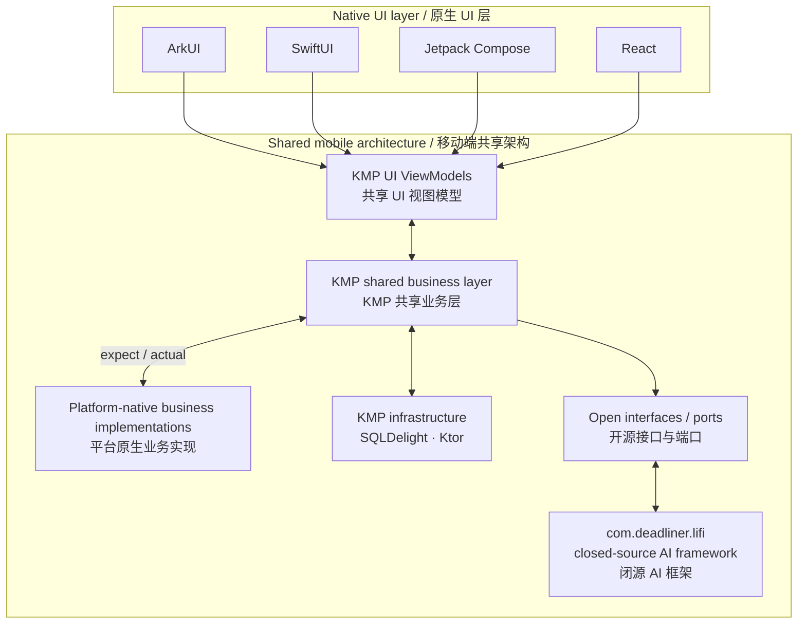
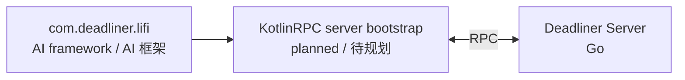

# DeadlinerStudio

> Make time visible. Make every day count.  
> 让时间可见，让每一天都有意义。

## About / 关于我们

**Deadliner** (Deadliner 待办日历) is a family of time-management applications that brings tasks, schedules, habits, and AI assistance into one focused workspace. We build native experiences for every platform while sharing the business capabilities that should remain consistent.

**Deadliner**（Deadliner 待办日历）是一组时间管理应用，将待办、日程、习惯与 AI 助手整合在一个专注的工作空间中。我们为各个平台打造原生体验，同时共享应保持一致的业务能力。

DeadlinerStudio is maintained by mobile developer [Aritx Zhou](https://github.com/AritxOnly), desktop developer [XiaoChennnng](https://github.com/XiaoChennnng), and product manager [qiao411](https://github.com/qiao411).

目前，DeadlinerStudio 由移动端开发 [Aritx Zhou](https://github.com/AritxOnly)、PC 端开发 [XiaoChennnng](https://github.com/XiaoChennnng) 与产品经理 [qiao411](https://github.com/qiao411) 共同维护。

## Products / 产品

| Platform / component 平台 / 组件 | Project 项目 | Technology 技术栈 | License / availability 许可 / 状态 |
| --- | --- | --- | --- |
| Android / 安卓 | [Deadliner](https://github.com/DeadlinerStudio/Deadliner) | Jetpack Compose | Open source · MIT 开源 · MIT |
| iOS | [Deadliner-iOS](https://github.com/AritxOnly/Deadliner-iOS) | SwiftUI | Open source · LGPL-2.1 开源 · LGPL-2.1 |
| macOS | [Deadliner-macOS](https://github.com/DeadlinerStudio/Deadliner-macOS) | SwiftUI | Open source · LGPL-2.1 开源 · LGPL-2.1 |
| HarmonyOS / 鸿蒙 | [DeadlinerNEXT](https://github.com/AritxOnly/DeadlinerNEXT) | ArkTS / ArkUI | Open source · LGPL-2.1 开源 · LGPL-2.1 |
| Desktop / 桌面端 | [Deadliner-Client](https://github.com/XiaoChennnng/Deadliner-Client) | Electron / React | Available 已可用 |
| Cross-platform core / 跨平台核心 | DeadlinerCore | Kotlin Multiplatform | Open source · MIT 开源 · MIT |
| AI framework / AI 框架 | Lifi | Kotlin | Closed source 闭源 |
| Backend / 服务端 | Deadliner Server | Go | In development 开发中 |

> Repository availability may evolve as the project matures. Please refer to each repository for its current status.
>
> 随着项目演进，仓库的可用性可能发生变化；请以各仓库中的当前说明为准。

## Mobile architecture / 移动端架构

The mobile architecture keeps UI native, while ViewModels and business capabilities are shared with Kotlin Multiplatform (KMP). The KMP business layer uses `expect` / `actual` contracts to work with platform-native implementations, and integrates with its own persistence and networking infrastructure through SQLDelight and Ktor. AI capabilities are accessed through open interfaces; the implementation lives in the closed-source `com.deadliner.lifi` framework.

移动端架构保留各平台原生 UI，同时通过 Kotlin Multiplatform（KMP）共享 ViewModel 与业务能力。KMP 共享业务层通过 `expect` / `actual` 契约与平台原生业务实现交互；内部则使用 SQLDelight 与 Ktor 对接持久化和网络基础能力。AI 能力通过开源接口访问，具体实现位于闭源的 `com.deadliner.lifi` 框架中。

### Service direction / 服务端规划

Lifi also includes a planned KotlinRPC server bootstrap. Together with the Go-based Deadliner Server product, it will form the service-side architecture.

Lifi 还包含一个待规划的 KotlinRPC 服务器 bootstrap；它将与 Go 实现的 Deadliner Server 产品共同构成服务端架构。

## Licensing and source availability / 许可与源码可用性

Deadliner is partly open source. Deadliner for Android and DeadlinerCore are released under the MIT License. Deadliner-iOS and DeadlinerNEXT are released under the GNU Lesser General Public License v2.1 (LGPL-2.1). Lifi—including its prompts, orchestration strategies, and AI implementation—is closed source and is only distributed where explicitly provided.

Deadliner 采用部分开源模式：Android 端与 DeadlinerCore 使用 MIT License；Deadliner-iOS 与 DeadlinerNEXT 使用 GNU Lesser General Public License v2.1（LGPL-2.1）。Lifi 的提示词、编排策略及 AI 实现均为闭源内容，仅在明确提供的范围内分发。

Each repository is the source of truth for its license text and contribution guidance.

各仓库中的许可证文本与贡献说明为最终准则。

## Get involved / 参与项目

Explore the repositories above, open an issue when you find a problem or have an idea, and follow the project as we bring Deadliner to more platforms.

欢迎浏览上方仓库；如果你发现问题或有好的想法，欢迎提交 Issue。也欢迎关注项目，与我们一起将 Deadliner 带到更多平台。

---

Built with care by [DeadlinerStudio](https://github.com/DeadlinerStudio).  
由 [DeadlinerStudio](https://github.com/DeadlinerStudio) 用心构建。
